# Business Processes & Application Flow Map — Caregiver Platform

## 1. System Overview & Core Actors

The Caregiver Platform manages multi-state home health operations across **Florida (`FL`)**, **Indiana (`IN`)**, and **Georgia (`GA`)**. All processes operate under strict state jurisdictional scoping and Role-Based Access Control (RBAC).

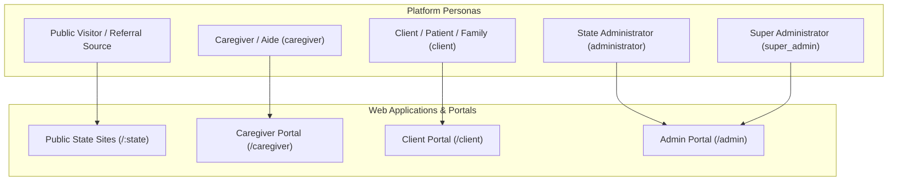

### Actor Capabilities Matrix
| Persona | Role Key | Jurisdictional Scope | Primary Responsibilities |
|---|---|---|---|
| **Public Visitor** | *None* | Selected state (`/:state`) | View services, licenses, career openings; download forms; submit referrals. |
| **Caregiver / Aide** | `caregiver` | Assigned state (`state_id`) | Submit application, upload credentials, track compliance, complete in-service training, review assigned client care plans & schedules. |
| **Client / Representative** | `client` | Assigned state (`state_id`) | Submit clinical intake, sign mandatory legal agreements, upload prior authorizations, view care plans & caregiver schedules. |
| **State Administrator** | `administrator` | Locked state (`state_id`) | Review caregiver applications, triage referrals, admit clients, review credentials, manage authorizations, enforce compliance gates, schedule shifts. |
| **Super Administrator** | `super_admin` | Global (`ALL` states) | Cross-state operational oversight, staff user management, role assignments, state scope configuration, compliance settings. |

---

## 2. Process 1: Public Marketing & Referral Acquisition

Handles regional prospective client discovery, job board recruitment, and lead acquisition.

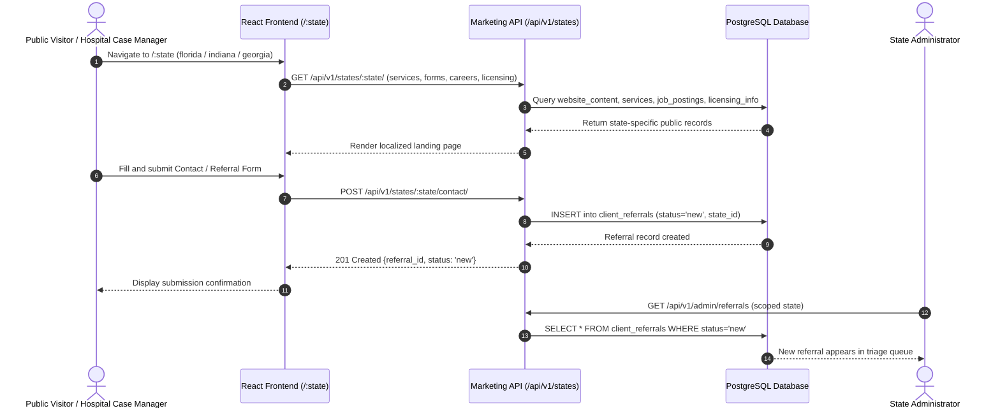

### Process Steps & Endpoints
1. **State Discovery (`GET /:state`)**: Loads public catalog (services, statutory licenses, career openings).
2. **Referral Submission (`POST /api/v1/states/<state>/contact/`)**: Unauthenticated submission capturing contact info, referral source, and clinical care needs.
3. **Database Insertion**: Persists in `client_referrals` with `status = 'new'`.

---

## 3. Process 2: Caregiver Recruitment, Atomic Onboarding & Credentialing

Manages the applicant lifecycle from public intake to credential review, background checks, and active employment readiness.

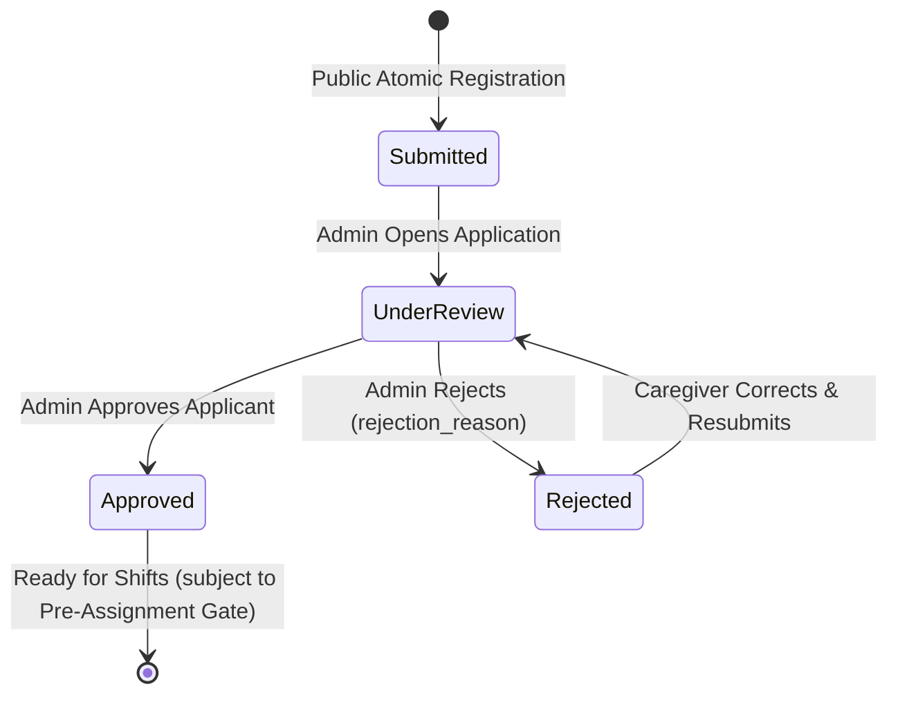

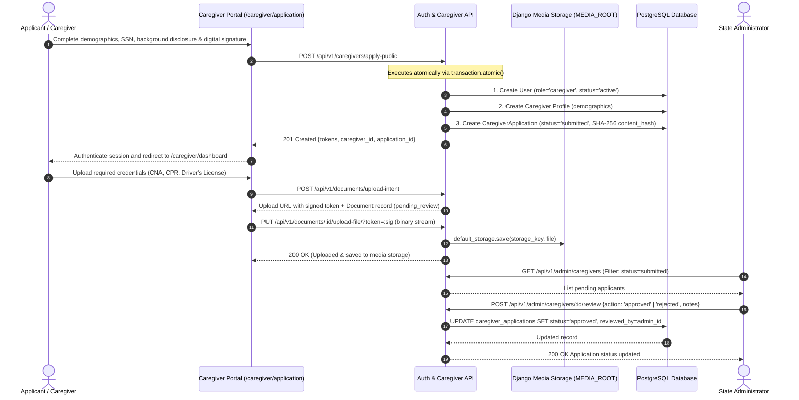

### Process Steps & Endpoints
1. **Public Intake (`POST /api/v1/caregivers/apply-public`)**: Single atomic transaction provisioning `users`, `caregivers`, and `caregiver_applications` with digital signature canvas data and SHA-256 non-repudiation `content_hash`.
2. **Credential Upload (`POST /api/v1/documents/upload-intent` & `PUT /upload-file/`)**: Requests signed upload URL; binary file streams directly to Django media storage (`backend/media/`, `documents.status = 'pending_review'`).
3. **Admin Review (`POST /api/v1/admin/caregivers/<application_id>/review`)**: Administrator approves (`approved`) or rejects (`rejected`) with required `rejection_reason`.
4. **Applicant Resubmission (`POST /api/v1/caregivers/applications/resubmit`)**: Allows rejected applicants to amend details, re-sign, and return application to `under_review`.

---

## 4. Process 3: In-Service Training & Certification

Enables caregivers to complete state-mandated continuing education and obtain regulatory proof of completion.

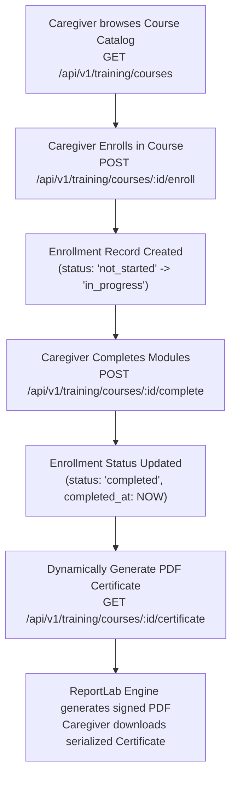

### Process Steps & Endpoints
1. **Browse Courses (`GET /api/v1/training/courses`)**: Lists mandatory curriculum (Infection Control, HIPAA, Dementia Care).
2. **Enrollment (`POST /api/v1/training/courses/<id>/enroll`)**: Initializes progress tracking (`training_enrollments`).
3. **Completion (`POST /api/v1/training/courses/<id>/complete`)**: Sets `completed_at` timestamp and status to `completed`.
4. **Certificate Retrieval (`GET /api/v1/training/courses/<id>/certificate`)**: Generates an audit-ready, serialized PDF certificate via ReportLab.

---

## 5. Process 4: Client Referral Triage, Intake & Legal Admission

Coordinates patient referrals, clinical intake packets, statutory legal agreements, and official service admission.

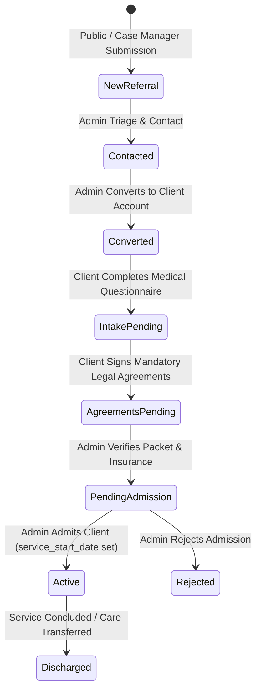

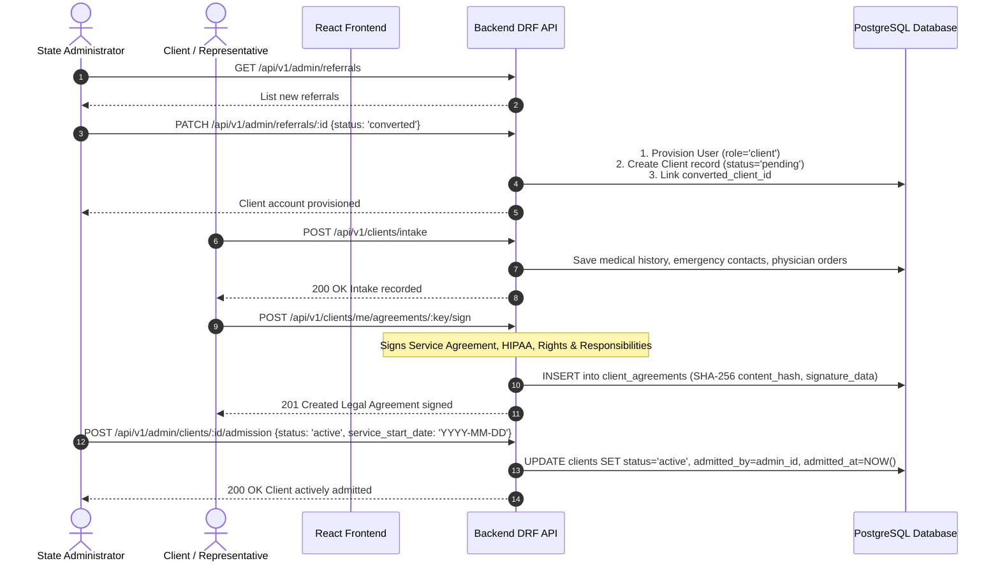

### Mandatory Statutory Agreements
1. **Home Care Service Agreement (`service_agreement`)**: Terms of non-medical personal care and hourly commitments.
2. **HIPAA Privacy Practices Notice (`hipaa_privacy`)**: Statutory medical data disclosure rights.
3. **Client Rights & Responsibilities (`client_rights`)**: Code of conduct, complaint escalation, and patient protections.

---

## 6. Process 5: Prior Authorization & HCPCS Burndown Management

Prevents Medicaid/commercial claim rejections by tracking approved units and active hour consumption.

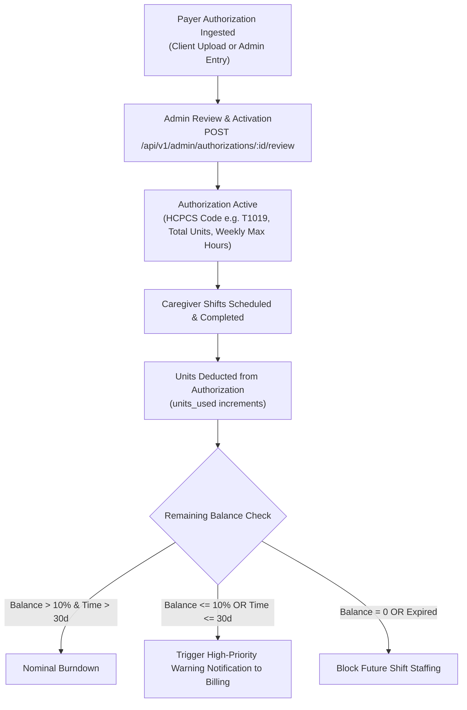

### Process Steps & Endpoints
1. **Ingest Authorization**:
   - Client Portal (`POST /api/v1/clients/me/authorizations`): Ingests with `source = 'client'`, `status = 'pending'`.
   - Admin Portal (`POST /api/v1/admin/authorizations`): Direct entry with `source = 'admin'`.
2. **Review & Activation (`POST /api/v1/admin/authorizations/<id>/review`)**: Sets authorized units, HCPCS code (`T1019`), unit type (`15_min`, `hourly`, `visit`), and weekly hour ceilings.
3. **Burndown Monitoring (`GET /api/v1/admin/authorizations/<id>`)**: Computes real-time unit balance and burn percentage.

---

## 7. Process 6: Clinical Care Directives, Scheduling & Staffing (Pre-Assignment Gate)

Connects admitted clients with qualified caregivers while enforcing automated, hard compliance barriers.

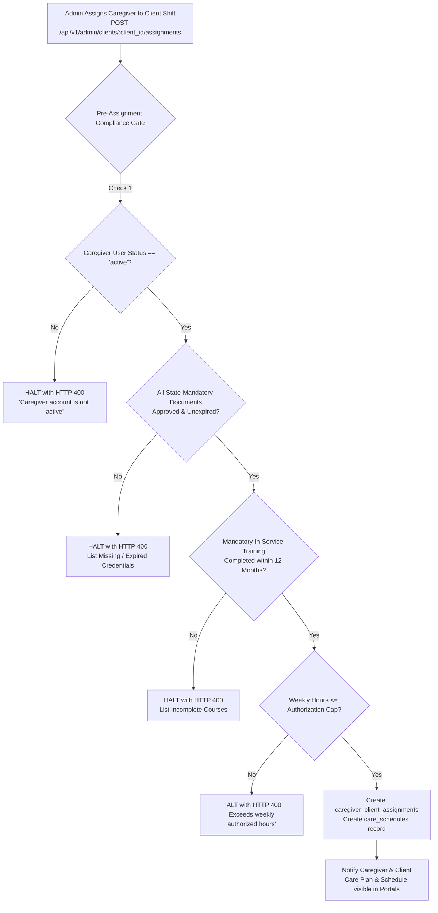

### Process Steps & Endpoints
1. **Care Plan Authoring (`POST /api/v1/admin/clients/<id>/care-plan`)**: Defines primary nurse, emergency contact protocol, and specific Activities of Daily Living (ADLs) with task frequencies.
2. **Weekly Shift Scheduling (`POST /api/v1/admin/clients/<id>/schedule`)**: Sets day-of-week, start/end hours, and service type.
3. **Pre-Assignment Compliance Verification (`POST /api/v1/admin/clients/<id>/assignments`)**:
   - Validates caregiver active account status.
   - Validates that all required state credentials exist, are approved, and have not expired.
   - Validates completion of all mandatory continuing education courses.
   - Rejects uncompliant assignments with specific diagnostic errors.
4. **Caregiver View (`GET /api/v1/caregivers/me/clients/<id>/care-plan`)**: Assigned caregiver receives scoped, read-only access to client directives and daily tasks.

---

## 8. Process 7: Document Management & Compliance Review Engine

Centralized ingestion and audit engine for all state and federal regulatory filings using built-in Django media storage (`backend/media/`, proxied via Vite `/media`) with cryptographic HMAC signed tokens.

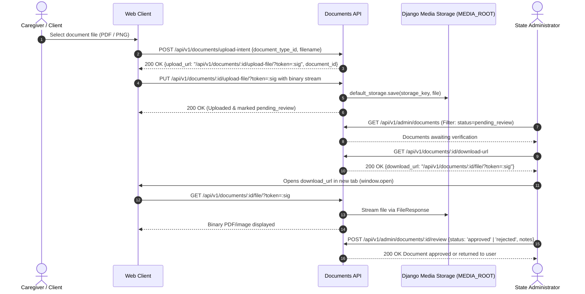

### Document Status Transitions
- `pending_review` $\rightarrow$ `approved` (Valid credential, expiration recorded).
- `pending_review` $\rightarrow$ `rejected` (Illegible, wrong type, or invalid issuer).
- `approved` $\rightarrow$ `expired` (Automated nightly expiration scanner detects date reached).

---

## 9. Process 8: Platform Governance, Audit Trails, Retention & User Administration

Maintains multi-tenant isolation, HIPAA compliance evidence, and account access.

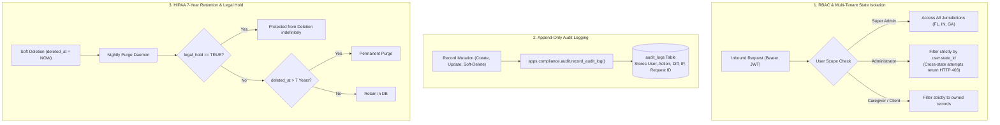

### Process Steps & Endpoints
1. **User Administration (`GET /api/v1/admin/users`)**: Search, filter, and inspect users across roles and jurisdictions.
2. **Account Status Control (`PATCH /api/v1/admin/users/<id>/status`)**: Transition accounts between `active`, `inactive`, and `suspended`.
3. **Role & Jurisdiction Management (`PATCH /api/v1/admin/users/<id>/role`, `/state`)**: Super Administrator reassignments of staff roles and regional oversight.
4. **Legal Hold Management (`POST /api/v1/admin/<resource>/<id>/legal-hold`)**: Flips legal hold flag to freeze records during regulatory inquiries.
5. **Entity Restoration (`POST /api/v1/admin/<resource>/<id>/restore`)**: Reverses soft-deletion before the 7-year purge horizon.
6. **Announcements Broadcast (`POST /api/v1/admin/announcements`)**: Broadcasts state-wide or role-targeted bulletins.
7. **Compliance Audit Trail (`GET /api/v1/admin/audit-logs`)**: Searchable, immutable record of all system events.

---

## 10. Summary of Business Domain Processes & Technical Mapping

| Domain / Process | Primary Endpoints | Database Entities Involved | Primary Outcome |
|---|---|---|---|
| **Marketing & Leads** | `GET /api/v1/states/:state/*` `POST /api/v1/states/:state/contact` | `website_content`, `services`, `job_postings`, `client_referrals` | Ingestion of qualified client inquiries into regional agency triage pipelines. |
| **Caregiver Onboarding** | `POST /api/v1/caregivers/apply-public` `POST /api/v1/admin/caregivers/:id/review` | `users`, `caregivers`, `caregiver_applications`, `documents` | Atomic applicant registration, background verification, credentialing approval. |
| **Continuing Education** | `GET /api/v1/training/courses` `POST /api/v1/training/courses/:id/complete` | `training_courses`, `training_enrollments` | Verification of continuing education hours and serialized completion certificates. |
| **Client Admission** | `POST /api/v1/clients/intake` `POST /api/v1/clients/me/agreements/:key/sign` `POST /api/v1/admin/clients/:id/admission` | `clients`, `client_agreements`, `client_referrals` | Complete digital medical intake, binding legal agreements, and active patient admission. |
| **Prior Authorization** | `POST /api/v1/admin/authorizations` `POST /api/v1/admin/authorizations/:id/review` | `authorizations`, `documents` | Continuous validation of Medicaid/insurance billing units and weekly hours limits. |
| **Care Directives & Staffing** | `POST /api/v1/admin/clients/:id/care-plan` `POST /api/v1/admin/clients/:id/schedule` `POST /api/v1/admin/clients/:id/assignments` | `care_plans`, `care_plan_activities`, `care_schedules`, `caregiver_client_assignments` | Structured ADL care directives, schedule planning, and pre-assignment credential validation. |
| **Compliance & Storage** | `POST /api/v1/documents/upload-intent` `PUT /api/v1/documents/:id/upload-file` `POST /api/v1/admin/documents/:id/review` | `document_types`, `document_requirements`, `documents` | Django media storage & HMAC signed tokens, multi-jurisdiction compliance matrix enforcement. |
| **System Governance** | `GET /api/v1/admin/audit-logs` `POST /api/v1/admin/:res/:id/legal-hold` `PATCH /api/v1/admin/users/:id/*` | `users`, `roles`, `states`, `audit_logs`, `announcements`, `notifications` | Fail-closed state isolation, HIPAA legal hold protection, and tamper-evident audit logging. |
