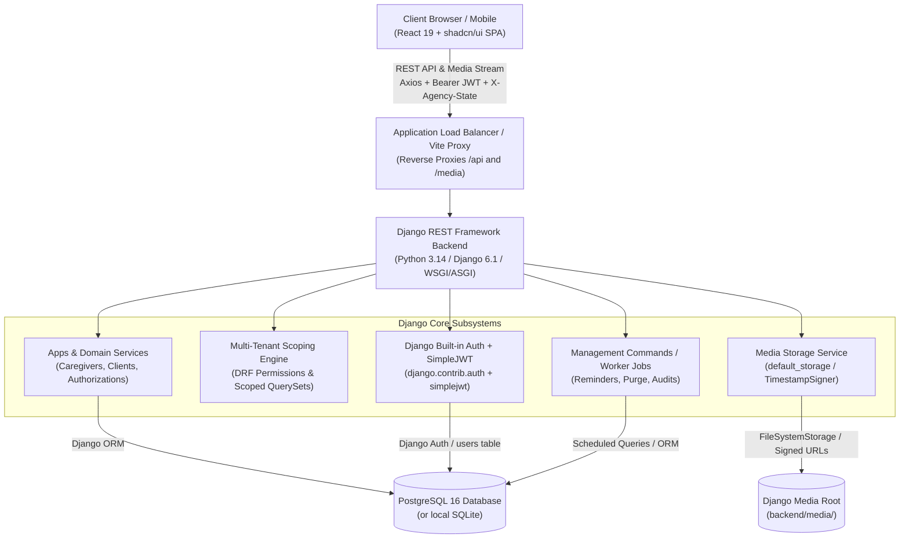
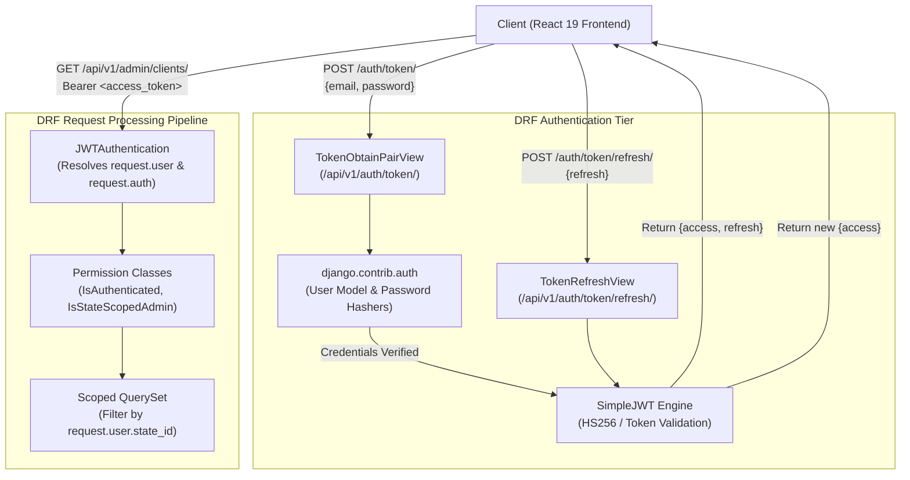
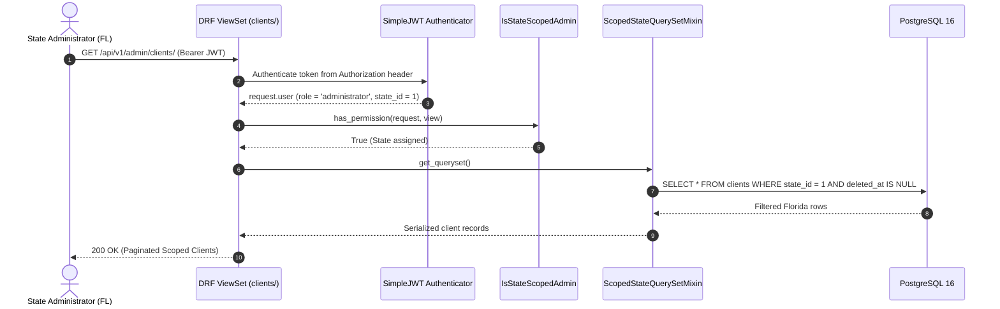
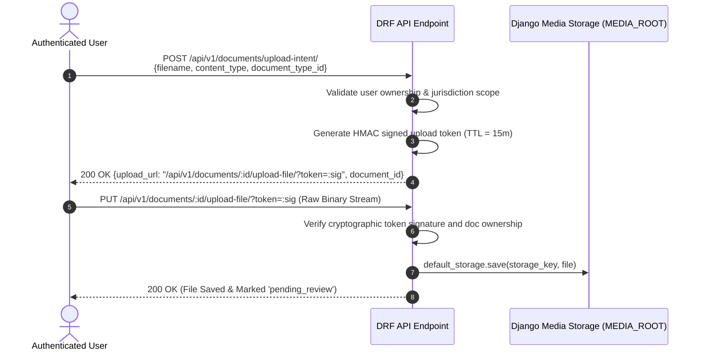
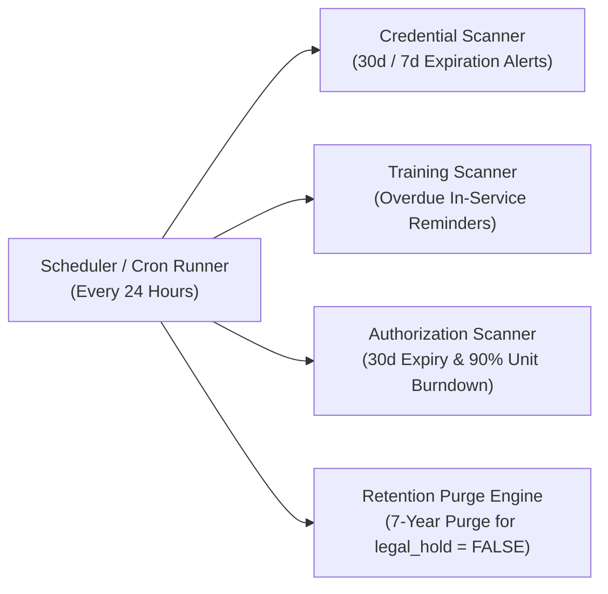
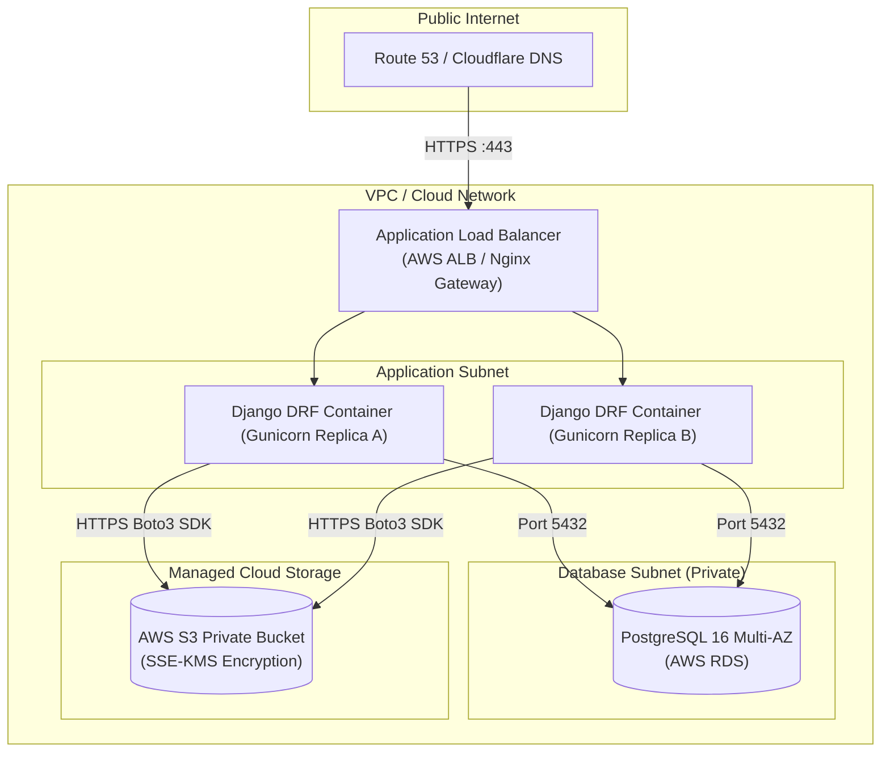

# Software Architecture Document (SAD) — Caregiver Platform

## 1. System Overview & Architectural Vision

The **Caregiver Platform** is an enterprise home health agency operating system serving Florida, Indiana, and Georgia.
This architecture is designed as a **modern cloud-native monolith**:
- **Monolithic Backend Core**: A Django REST Framework (DRF) backend on Python 3.14 (3.12+) with clean layered separation of concerns (Views/ViewSets -> Serializers -> Domain Services/Managers -> Models/ORM -> Persistence).
- **Single Page Application (SPA)**: A React 19 frontend compiled with Vite, styled with Tailwind CSS v4 and shadcn/ui, using React Hook Form for client validations, TanStack Query (React Query v5) for server cache management, and Axios for HTTP transport with multi-state and JWT header injection.
- **Pure Relational Engine**: Standard PostgreSQL 16+ managed through Django ORM and migrations, serving as the single source of truth for transactional data, compliance audits, and multi-tenant state isolation.
- **Built-in Django Media Storage**: Native Django media storage engine (`MEDIA_ROOT` / `FileSystemStorage`) paired with cryptographic HMAC signed tokens for direct uploads and streaming downloads, proxied via Vite `/media`, with optional AWS S3 support (`USE_S3=true`).
- **Built-in Authentication & SimpleJWT**: Self-hosted authentication utilizing Django's native authentication system (`django.contrib.auth`) paired with `djangorestframework-simplejwt` for RFC 7519 JSON Web Token issuance and rotation, eliminating external BaaS dependencies.



---

## 2. Architectural Principles & Tenets

1. **State as Data and Authorization Boundary**: Multi-tenancy is structured around jurisdictions (FL, IN, GA). The backend strictly enforces state isolation at the DRF permission class (`BasePermission`) and model `QuerySet` layer. No per-state server forks or isolated databases.
2. **Clean Layered Monolith**: High cohesiveness with low coupling. Business logic is organized in modular Django apps (`apps/<domain>/`), validation in `serializers.py`, views in `views.py` / `viewsets.py`, and data access in models and custom `QuerySet` managers.
3. **Zero Client Trust**: All user roles, state scopes, and permissions are determined from verified JWT claims and database state—never from query parameters or body payloads.
4. **Presigned Storage Access**: Binary documents never transit through backend application memory during upload/download. Clients read and write directly to the AWS S3 bucket via time-bounded presigned URLs.
5. **Database Immutability for Legal Evidence**: Audit logs (`audit_logs`) and signed client agreements (`client_agreements`) are strictly append-only. Deletions across operational entities are handled through soft deletion with legal hold protection.

---

## 3. Technology Stack Reference

| Tier | Component | Selection | Rationale |
|---|---|---|---|
| **Frontend** | Framework | **React 19** | Modern UI lifecycle, high rendering efficiency, robust component ecosystem. |
| | Build Tool | **Vite (v8+)** | Sub-second HMR, native ES module resolution, optimized tree-shaking. |
| | Styling & Primitives | **Tailwind CSS (v4) + shadcn/ui** | Semantic token architecture, accessible primitives, zero-slop UI components. |
| | Form Engine | **React Hook Form (v7+)** | Minimal re-renders, uncontrolled input performance, deep schema validation. |
| | State & Fetching | **TanStack Query (React Query v5)** | Declarative server cache management, automated deduplication, and cache invalidation. |
| | HTTP Client | **Axios (v1+)** | Unified instance with auto-token injection and `X-Agency-State` header forwarding. |
| | Routing | **React Router v6** | Declarative portal routing and role-based route guards. |
| **Backend** | Runtime & API | **Django REST Framework (DRF 3.18+) on Django 6.1+ (Python 3.14/3.12+)** | Battle-tested monolith framework, declarative views and viewsets, robust request routing, and built-in administrative capabilities. |
| | Data Validation | **DRF Serializers / ModelSerializers** | Declarative schema validation, nested payload handling, and standardized error formatting. |
| | ORM & DB Engine | **Django ORM + Psycopg** | Native query compilation, transaction management, connection pooling, and multi-database compatibility. |
| | Migrations | **Django Migrations (`manage.py`)** | Deterministic, version-controlled schema evolution and automatic migration generation. |
| | Web Server | **WSGI / ASGI (Gunicorn / Uvicorn)** | High-concurrency Python application server running behind ALB/Nginx. |
| | Auth & Security | **Django Built-in Auth (`django.contrib.auth`) + SimpleJWT (`djangorestframework-simplejwt 5.5+`)** | Natively integrated user management, secure password hashing, and stateless RFC 7519 JWT access/refresh token pair lifecycle. |
| | File Storage | **Built-in Django Media (`FileSystemStorage`)** | Native Django media storage in `MEDIA_ROOT` with HMAC signed upload/download tokens; optional S3 via `USE_S3=true`. |
| | PDF Engine | **ReportLab** | Server-side programmatic PDF generation for training certificates. |
| **Data & Storage**| Primary Database | **PostgreSQL 16** | ACID compliance, JSONB support, composite partial indexes, transactional stored procedures (or SQLite locally). |
| | File Storage | **Django `MEDIA_ROOT` (local) / S3 (cloud)** | Local disk storage with URL reverse proxying via Vite and optional AWS S3 bucket. |

---

## 4. Django REST Framework Ecosystem Architectural Blueprint

### 4.1 Authentication Architecture (Django Built-in Auth & SimpleJWT)

The authentication tier relies entirely on Django's native authentication framework paired with `djangorestframework-simplejwt`:



#### Core Components:
1. **User Identity & Storage**: Users are managed via a custom Django User model (`AbstractBaseUser`, `PermissionsMixin`) mapped to the `users` table, supporting UUID primary keys, active/inactive states, and state-jurisdiction foreign keys.
2. **Credential Verification**: Password hashing uses Django's secure password hashers (Argon2 / PBKDF2), executed via standard `authenticate(email=..., password=...)`.
3. **Token Pair Generation**: `rest_framework_simplejwt.views.TokenObtainPairView` issues:
   - **Access Token**: Short-lived (60 minutes) signed JWT containing identity and claim payloads (`user_id`, `role`, `state_id`).
   - **Refresh Token**: Long-lived (7 days) signed JWT with rotation enabled to issue new access tokens.
4. **Token Decoding & Request Context**: The `JWTAuthentication` class inspects the `Authorization: Bearer <token>` header, verifies the signature using `SIMPLE_JWT['SIGNING_KEY']`, and attaches the resolved database `User` instance to `request.user`.

### 4.2 DRF Settings, Permissions & State Scoping Engine

#### Global DRF Configuration (`config/settings.py`):
```python
from datetime import timedelta

REST_FRAMEWORK = {
    "DEFAULT_AUTHENTICATION_CLASSES": (
        "rest_framework_simplejwt.authentication.JWTAuthentication",
    ),
    "DEFAULT_PERMISSION_CLASSES": (
        "rest_framework.permissions.IsAuthenticated",
    ),
    "DEFAULT_PAGINATION_CLASS": "rest_framework.pagination.PageNumberPagination",
    "PAGE_SIZE": 25,
}

SIMPLE_JWT = {
    "ACCESS_TOKEN_LIFETIME": timedelta(minutes=60),
    "REFRESH_TOKEN_LIFETIME": timedelta(days=7),
    "ROTATE_REFRESH_TOKENS": True,
    "BLACKLIST_AFTER_ROTATION": True,
    "ALGORITHM": "HS256",
    "SIGNING_KEY": SECRET_KEY,
    "AUTH_HEADER_TYPES": ("Bearer",),
    "USER_ID_FIELD": "id",
    "USER_ID_CLAIM": "sub",
}
```

#### State Scoping Permission Class (`apps/core/permissions.py`):
```python
from rest_framework.permissions import BasePermission
from rest_framework.exceptions import PermissionDenied

class IsStateScopedAdmin(BasePermission):
    """
    Grants access to super_admin across all states,
    or administrators strictly within their assigned state jurisdiction.
    """
    def has_permission(self, request, view):
        user = request.user
        if not user or not user.is_authenticated:
            return False
        
        role_name = getattr(user.role, "name", None)
        if role_name == "super_admin":
            return True
        if role_name == "administrator":
            if user.state_id is None:
                raise PermissionDenied("Administrator is not assigned to a state jurisdiction.")
            return True
        return False

    def has_object_permission(self, request, view, obj):
        role_name = getattr(request.user.role, "name", None)
        if role_name == "super_admin":
            return True
        if role_name == "administrator":
            return getattr(obj, "state_id", None) == request.user.state_id
        return False
```

#### Scoped QuerySet Mixin (`apps/core/mixins.py`):
```python
from rest_framework.exceptions import PermissionDenied

class ScopedStateQuerySetMixin:
    """
    Automatically restricts queryset results to the state assigned to the administrator.
    """
    def get_queryset(self):
        user = self.request.user
        qs = super().get_queryset()
        role_name = getattr(user.role, "name", None)
        
        if role_name == "super_admin":
            return qs
        if role_name == "administrator" and user.state_id:
            return qs.filter(state_id=user.state_id)
        
        raise PermissionDenied("User does not have an active jurisdictional scope.")
```

### 4.3 Serializers & Request/Response Validation

All request payloads and response representations utilize DRF Serializers:
- **`ModelSerializer` Enforcement**: Enforces field validation, relations, and output sanitization directly mapped to Django models.
- **Strict Data Validation**: Custom `validate_<field>()` and `validate()` methods enforce jurisdictional invariants and HIPAA data integrity.
- **RFC 7807 Error Responses**: Custom DRF exception handler (`custom_exception_handler`) standardizes validation error dicts into structured, traceable JSON payloads.

### 4.4 Repository & Directory Map

```
backend/
├── manage.py                         # Django administrative runner
├── venv/                             # Virtual environment (Python 3.14 / Django 6.1)
├── config/                           # Project configuration & ASGI/WSGI
│   ├── __init__.py
│   ├── settings/                     # Environment-specific settings
│   │   ├── base.py                   # Common DRF, SimpleJWT, and DB configuration
│   │   ├── development.py            # Local developer configuration
│   │   └── production.py             # Cloud AWS RDS / S3 production configuration
│   ├── urls.py                       # Root URLconf (/api/v1/ routers)
│   ├── wsgi.py                       # WSGI entrypoint for Gunicorn
│   └── asgi.py                       # ASGI entrypoint for async workloads
├── apps/                             # Modular Django Business Applications
│   ├── core/                         # Shared utilities, base models, S3 adapters
│   │   ├── models.py                 # TimeStampedModel, SoftDeleteModel
│   │   ├── permissions.py            # IsStateScopedAdmin, RoleRequired permissions
│   │   ├── mixins.py                 # ScopedStateQuerySetMixin
│   │   ├── storage.py                # Boto3 AWS S3 Presigned URL service
│   │   └── exceptions.py             # Custom DRF exception handlers
│   ├── authentication/               # Django Auth & SimpleJWT integration
│   │   ├── models.py                 # Custom User, Role models
│   │   ├── serializers.py            # CustomTokenObtainPairSerializer, UserSerializer
│   │   ├── views.py                  # Token views and registration
│   │   └── urls.py
│   ├── caregivers/                   # Caregiver profiles, applications, onboarding
│   │   ├── models.py
│   │   ├── serializers.py
│   │   ├── views.py
│   │   └── urls.py
│   ├── clients/                      # Client records, state assignments, agreements
│   │   ├── models.py
│   │   ├── serializers.py
│   │   ├── views.py
│   │   └── urls.py
│   ├── authorizations/               # Medicaid/insurance authorizations & burndown
│   ├── documents/                    # Clinical & credential documents, S3 upload intents
│   └── compliance/                   # Append-only audit logs, background checks, training
```

---

## 5. Security & Multi-Tenancy Architecture

### 5.1 Multi-Tenant State Isolation Mechanics
The platform operates as a shared-process, shared-database multi-tenant system where each state (`state_id = 1` for FL, `2` for IN, `3` for GA) is an **authorization boundary**.



#### Fail-Closed Enforcement Rules:
1. **Unscoped Administrator Denied**: If a user has `role = 'administrator'` but `state_id IS NULL`, `IsStateScopedAdmin` halts execution and raises `HTTP 403 Forbidden` (`"Administrator is not assigned to a state jurisdiction."`).
2. **Cross-State Injection Defense**: If a Florida administrator attempts to query Georgia records (`GET /api/v1/admin/clients/<uuid-ga>/`), `has_object_permission` validates `obj.state_id == request.user.state_id` and aborts with `HTTP 403 Forbidden`.
3. **Super Admin Exemption**: Users with `role = 'super_admin'` have `state_id = NULL` and bypass state filtering, permitting queries across all jurisdictions.

---

## 6. Document Storage Architecture (Built-in Django Media & Signed Tokens)

Large binary files (credentials, medical records, insurance cards) are stored securely using Django's built-in media storage (`MEDIA_ROOT` / `FileSystemStorage`), with reverse-proxying through Vite (`/media`) and optional AWS S3 support (`USE_S3=true`). Security and non-repudiation are enforced via cryptographic HMAC signed tokens generated by `django.core.signing.TimestampSigner`.



### Download Sequence:
1. Caller invokes `GET /api/v1/documents/{id}/download-url/` (Bearer JWT authenticated).
2. Backend checks caller authorization (owner of the document OR scoped administrator for that state OR super admin).
3. Backend generates an HMAC-signed download URL (`/api/v1/documents/{id}/file/?token=:sig`) or direct media path (`/media/{storage_key}`).
4. Caller opens download URL; `DocumentDirectFileView` streams the file via `FileResponse` with verified MIME type and filename.

---

## 7. Atomic Onboarding & Cryptographic Integrity Architecture

### 7.1 Atomic Caregiver Application Submission
Caregiver onboarding executes within a single database transaction via Django's `transaction.atomic()` to guarantee no orphan user accounts or half-filled applications exist:

```python
# apps/caregivers/services.py
from django.db import transaction
from django.contrib.auth import get_user_model
from apps.caregivers.models import Caregiver, CaregiverApplication

User = get_user_model()

@transaction.atomic
def submit_caregiver_application(data: dict) -> CaregiverApplication:
    # 1. Create or update user identity record
    user, _ = User.objects.update_or_create(
        email=data["email"],
        defaults={
            "role_id": 3,
            "state_id": data["state_id"],
            "status": "active",
        }
    )
    if "password" in data:
        user.set_password(data["password"])
        user.save()

    # 2. Upsert caregiver profile record
    caregiver, _ = Caregiver.objects.update_or_create(
        user=user,
        defaults={
            "state_id": data["state_id"],
            "first_name": data["first_name"],
            "last_name": data["last_name"],
            "phone": data["phone"],
            "date_of_birth": data["date_of_birth"],
            "ssn_last4": data["ssn_last4"],
        }
    )

    # 3. Create submitted application record with legal non-repudiation
    application = CaregiverApplication.objects.create(
        caregiver=caregiver,
        state_id=data["state_id"],
        status="submitted",
        signature_data=data["signature_data"],
        signed_name=data["signed_name"],
        content_hash=data["content_hash"],
        version=1,
    )
    return application
```

### 7.2 Cryptographic Content Hash Verification
For both caregiver applications and client legal agreements (`client_agreements`), the backend computes:
$$\text{content\_hash} = \text{SHA256}(\text{canonical\_json}(\text{payload}) \parallel \text{signed\_name} \parallel \text{signed\_at})$$
This ensures mathematical non-repudiation and guarantees that application or agreement contents cannot be altered without detection.

---

## 8. Asynchronous Jobs & Scheduled Tasks Architecture

Background daemon jobs execute as Django management commands orchestrated by cloud schedulers (e.g., AWS EventBridge / ECS Scheduled Tasks, Celery Beat, or system cron):



- **Idempotency**: All notification generation uses deterministic `reference_id` strings (e.g., `cred_exp_{doc_id}_{timestamp_date}`) to prevent duplicate notifications.
- **Legal Hold Exemption**: The purge engine executes safely via the ORM:
  ```python
  from datetime import timedelta
  from django.utils import timezone
  from apps.clients.models import Client

  cutoff = timezone.now() - timedelta(days=7 * 365)
  Client.objects.filter(deleted_at__lt=cutoff, legal_hold=False).delete()
  ```

---

## 9. Deployment & Infrastructure Blueprint



### Deployment Properties:
1. **Stateless Backend**: The Django REST Framework container maintains no in-memory session state; access and refresh tokens are stateless JWTs, supporting horizontal scaling across multiple container replicas out-of-the-box.
2. **Database Connection Pooling**: Configured via PostgreSQL persistent connections (`CONN_MAX_AGE`) or an RDS Proxy / PgBouncer pooler.
3. **Database Migrations**: Standard schema migrations applied automatically during deployment pipeline pre-flight steps via `python manage.py migrate --noinput`.

---

## 10. Frontend Architecture Blueprint (React 19, shadcn/ui, TanStack Query, Axios)

### 10.1 Frontend Directory Structure

```
frontend/
├── package.json                      # React 19, @tanstack/react-query, react-hook-form, axios, tailwindcss v4
├── vite.config.js                    # Vite 8 with @tailwindcss/vite and @/* alias
├── jsconfig.json                     # Path alias configuration (@/* -> src/*)
├── index.html                        # SPA HTML entry point
└── src/
    ├── main.jsx                      # App root with QueryClientProvider
    ├── App.jsx                       # Master portal router & state providers
    ├── index.css                     # Tailwind CSS v4 @import and healthcare semantic variables
    ├── lib/
    │   ├── api.js                    # Pre-configured Axios instance (JWT + X-Agency-State)
    │   ├── queryClient.js            # TanStack QueryClient with production cache policies
    │   └── utils.js                  # shadcn cn() class merger
    ├── components/
    │   ├── ui/                       # shadcn primitives (Button, Table, Dialog, Badge, Alert)
    │   ├── shared/                   # StateSelector, ComplianceBadge, NavigationBar
    │   └── forms/                    # Form fields and validation wrappers
    ├── features/
    │   ├── caregivers/               # Onboarding forms, credential uploaders, training viewer
    │   ├── clients/                  # Intake wizards, authorization burndown cards
    │   └── admin/                    # Compliance grid, split-screen document verification drawer
    └── hooks/                        # Custom react-query queries and mutations
```

### 10.2 HTTP & Multi-State Scoping Transport (`src/lib/api.js`)

Axios acts as the uniform HTTP transport boundary. All outbound requests automatically inject:
1. **Bearer JWT**: Extracted from local session storage (`Authorization: Bearer <access_token>`).
2. **Jurisdiction Header**: `X-Agency-State: FL | IN | GA` extracted from current user session, enabling DRF multi-tenant scoping without URL parameter pollution.

```javascript
// src/lib/api.js
import axios from 'axios'

export const api = axios.create({
  baseURL: import.meta.env.VITE_API_URL || '/api',
  headers: { 'Content-Type': 'application/json' },
  timeout: 15000,
})

api.interceptors.request.use((config) => {
  const token = localStorage.getItem('token')
  if (token) config.headers.Authorization = `Bearer ${token}`
  
  const activeState = localStorage.getItem('selected_state') || 'FL'
  config.headers['X-Agency-State'] = activeState
  return config
})
```

### 10.3 Server State Caching (`src/lib/queryClient.js`)

TanStack Query v5 manages asynchronous server state, deduplication, and cache invalidation:
- **`staleTime: 5 * 60 * 1000` (5 minutes)**: Prevents redundant background queries for stable compliance checklists.
- **`gcTime: 30 * 60 * 1000` (30 minutes)**: Garbage collection retention for inactive tabs.
- **Scoped Cache Keys**: Keys include state jurisdiction: `['caregivers', selectedState, 'compliance']`.

```javascript
// src/main.jsx
import { StrictMode } from 'react'
import { createRoot } from 'react-dom/client'
import { QueryClientProvider } from '@tanstack/react-query'
import { queryClient } from './lib/queryClient.js'
import App from './App.jsx'

createRoot(document.getElementById('root')).render(
  <StrictMode>
    <QueryClientProvider client={queryClient}>
      <App />
    </QueryClientProvider>
  </StrictMode>
)
```

### 10.4 Form Handling & Validation Pattern

Forms (Caregiver Onboarding, Client Intake, Document Expiry Entry) use **React Hook Form**:
- **Performance**: Uncontrolled input refs eliminate unnecessary component re-renders during high-frequency typing.
- **Integration**: Plugs directly into shadcn/ui components (`Input`, `Select`, `ToggleGroup`) using `register` and controller bindings.
- **Mutations**: Form submissions trigger TanStack `useMutation` calls to `api`, followed by targeted query cache invalidations via `queryClient.invalidateQueries()`.

